# Active Directory Lab: Windows Client Management & Group Policy

A hands-on home lab where I built a Windows Server 2022 domain controller, joined a Windows 11 workstation to the domain, set up department file shares with group-based access, enforced security settings with Group Policy, and worked through two realistic help desk troubleshooting scenarios.

**Skills demonstrated:** Active Directory Domain Services, DNS, Group Policy (security settings and Group Policy Preferences), NTFS and share permissions, domain join, PowerShell administration, and structured troubleshooting with `ipconfig`, `nslookup`, `Test-NetConnection`, and `gpresult`.

---

## Lab Environment

| Component | Details |
|---|---|
| Host | Lenovo laptop, Windows 11 Home |
| Hypervisor | VMware Workstation Pro 26H1 (see [Challenge: Hypervisor Conflict](#challenge-hypervisor-conflict)) |
| Domain controller | **DC01**: Windows Server 2022 Standard (Desktop Experience), AD DS + DNS, static IP `192.168.51.10` |
| Workstation | **CLIENT01**: Windows 11 Enterprise, domain-joined, DNS pointed at DC01 |
| Domain | `iamlab.internal` (NetBIOS `IAMLAB`) |
| Network | VMware NAT network `192.168.51.0/24`, gateway and upstream DNS `192.168.51.2` |

Both VMs running in VMware Workstation: DC01 at its lock screen, and CLIENT01 ready for a domain user (Maria Lopez) to sign in:

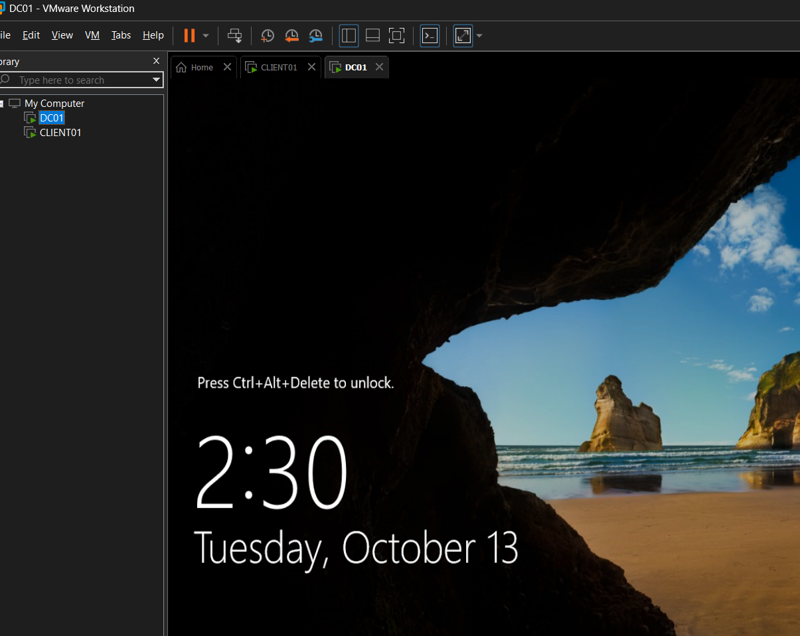
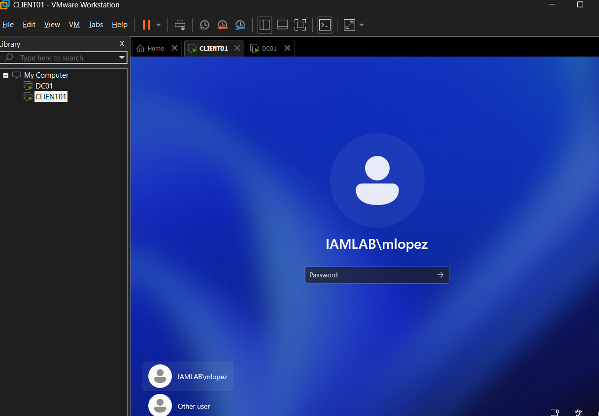

I used `.internal` instead of `.local` for the domain name because `.local` conflicts with multicast DNS (Bonjour) on macOS and Linux, and `.internal` is reserved for private networks.

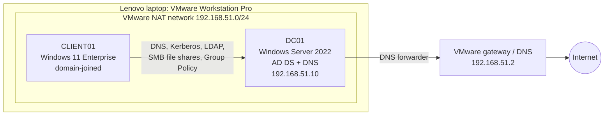

---

## Challenge: Hypervisor Conflict

I started the lab in VirtualBox, but the Windows Server installer kept freezing on the boot screen. Instead of guessing, I checked the VirtualBox log, and found that VirtualBox couldn't use the CPU's hardware virtualization directly:

```
HM: HMR3Init: Attempting fall back to NEM: AMD-V is not available
```

Windows 11's **Virtualization-Based Security** (VBS) was running Windows' own hypervisor, which took control of AMD-V and forced VirtualBox into a much slower compatibility mode:

```
VirtualizationBasedSecurityStatus : 2   (2 = running)
```

**What I tried:**
1. Turned off Memory Integrity, and disabled the `VirtualMachinePlatform` and `HypervisorPlatform` Windows features.
2. Set `bcdedit /set hypervisorlaunchtype off`. Because the laptop uses BitLocker, I first saved the recovery key off the device and suspended BitLocker for one reboot with `manage-bde -protectors -disable C: -RebootCount 1`, so the boot configuration change wouldn't trigger a recovery prompt.
3. Disabled VBS in the registry.

VBS kept running after restarts, and a later Windows update reset the boot setting. Rather than keep weakening the host's security, I **switched to VMware Workstation Pro**, which runs on top of Windows' hypervisor through Windows Hypervisor Platform. That let me **turn Memory Integrity back on** and keep the host fully protected, while the lab VMs ran normally.

**Takeaway:** when a security control conflicts with a tool, look for a tool that works *with* the control before disabling it.

---

## 1. Domain Controller Setup

### Static IP
A domain controller needs an address that never changes, because every domain member finds it through DNS. I assigned `192.168.51.10`, outside the NAT network's automatic (DHCP) range, and confirmed internet access still worked.

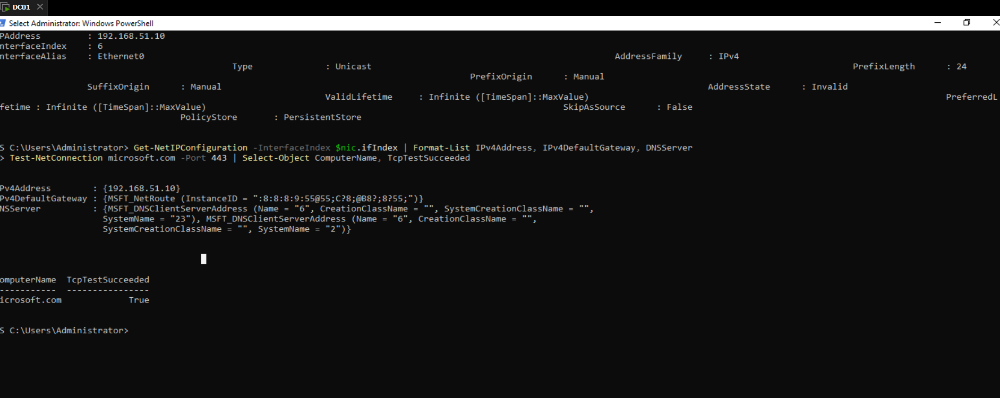

### Install AD DS and create the forest
```powershell
Install-WindowsFeature AD-Domain-Services -IncludeManagementTools

# DSRM (Directory Services Restore Mode) password, read as a SecureString so it never appears on screen or in history
$dsrm = Read-Host -AsSecureString "Enter DSRM password"

# Dry run first, then the real promotion
Test-ADDSForestInstallation -DomainName "iamlab.internal" -DomainNetbiosName "IAMLAB" -InstallDns -SafeModeAdministratorPassword $dsrm
Install-ADDSForest          -DomainName "iamlab.internal" -DomainNetbiosName "IAMLAB" -InstallDns -SafeModeAdministratorPassword $dsrm
```

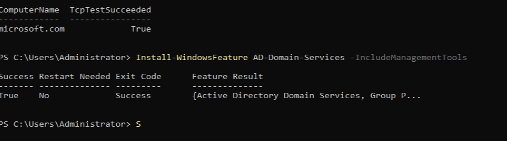
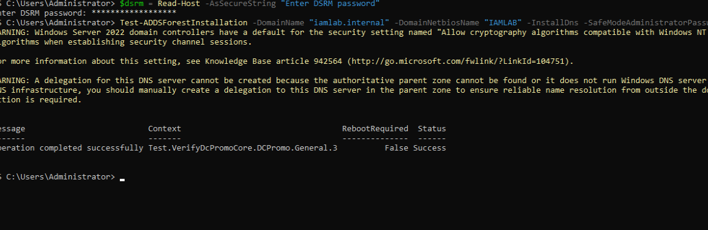

My first DSRM password was rejected by the domain password policy for being too short. The password policy was doing its job, so I chose a longer one.

After the restart, the sign-in screen showed the new domain account:

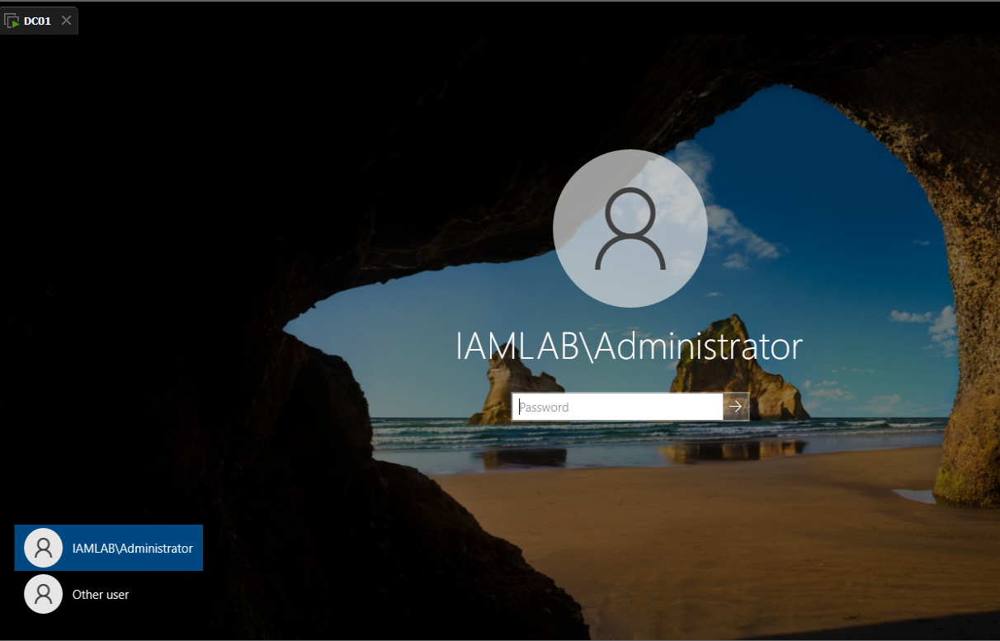

### Verification
| Check | Result |
|---|---|
| Signed-in identity | `iamlab\administrator` |
| Domain | `iamlab.internal`, NetBIOS `IAMLAB`, PDC emulator `DC01.iamlab.internal` |
| Core services | DNS, KDC (Kerberos), Netlogon, NTDS: all running |
| DC01's own DNS client | `127.0.0.1` (a DC points to itself) |
| DNS forwarder | `192.168.51.2` (internet lookups go upstream) |

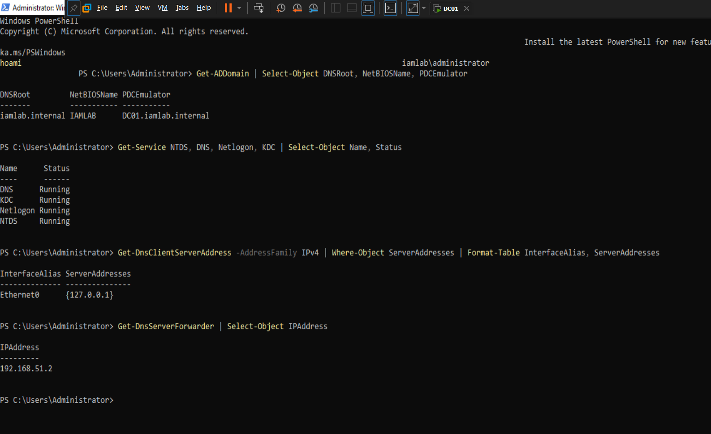

---

## 2. OU Structure and Test Users

I created a top-level `IAMLab` OU instead of using the default `Users` and `Computers` containers, because **Group Policy can't be linked to those default containers**.

```
iamlab.internal
└── IAMLab
    ├── Users
    │   ├── IT        (Kevin Nguyen, Help Desk Technician)
    │   ├── HR        (Maria Lopez, HR Specialist)
    │   ├── Finance   (James Carter, Sophie Martin)
    │   └── Sales     (Aisha Bello, Daniel Joseph)
    ├── Computers     (CLIENT01)
    ├── Groups        (department security groups)
    └── Disabled      (reserved for offboarded accounts)
```

I created six fictional employees with PowerShell, previewing with `-WhatIf` first. Each account was set to **require a password change at first sign-in**, so after that first sign-in only the user knows their password.

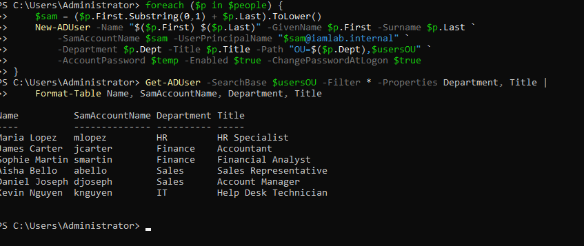
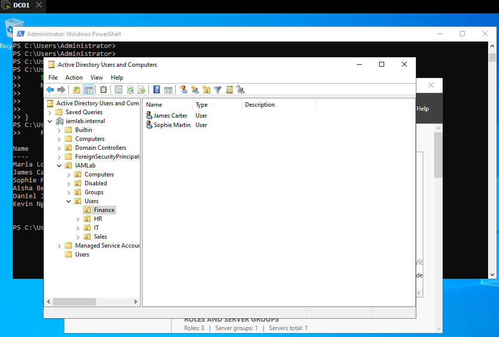

---

## 3. Windows 11 Client and Domain Join

**Small issue during setup:** CLIENT01's first boot showed `SATA CDROM Drive ... No Media` and fell through to network boot. The Windows 11 ISO wasn't attached to the VM's virtual CD drive. I attached it in the VM settings and enabled "Connect at power on."

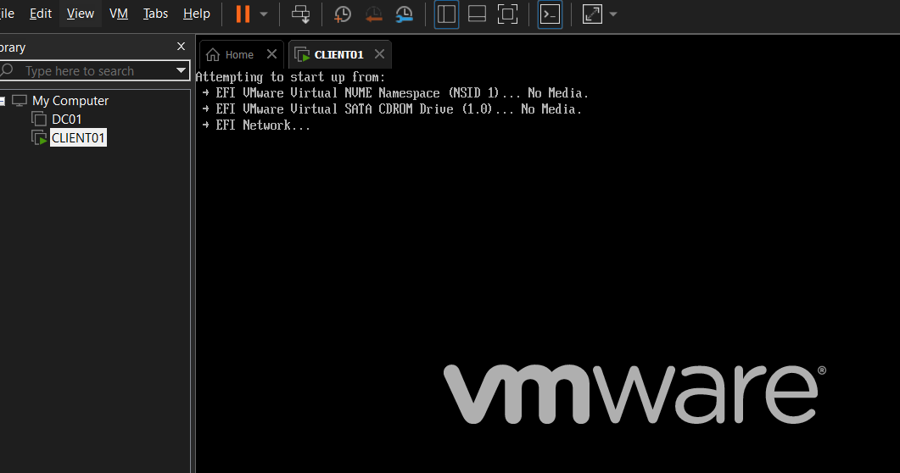

### Point DNS at the domain controller
Domain-joined computers find their domain controller through DNS, so I set CLIENT01's DNS server to `192.168.51.10`, then confirmed both name resolution and LDAP connectivity before joining:

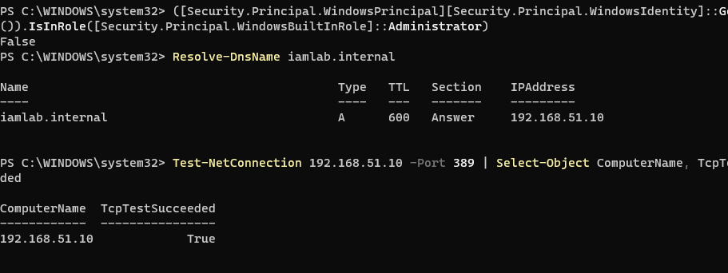

### Join the domain
I joined through **Settings → Accounts → Access work or school → Join this device to a local Active Directory domain**. DC01 created a computer account for CLIENT01:

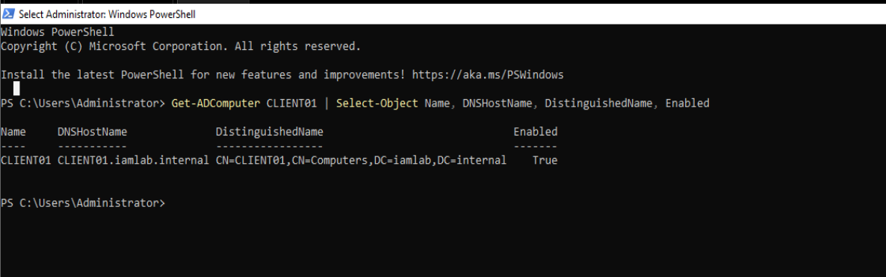

New computers land in the default `CN=Computers` container, so I moved CLIENT01 into `OU=Computers,OU=IAMLab` where my policies are linked. (Scenario 2 below shows what happens when that step is missed.)

### First domain sign-in
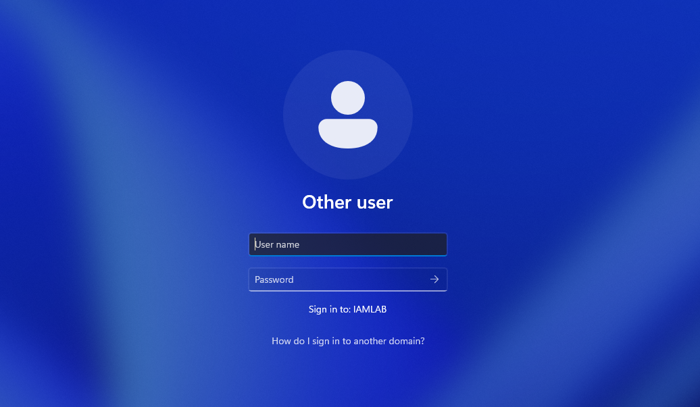
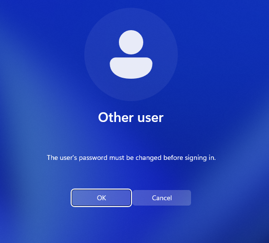

Signed in as Maria Lopez, `gpresult` confirmed she's in the HR OU and receiving Group Policy from DC01:

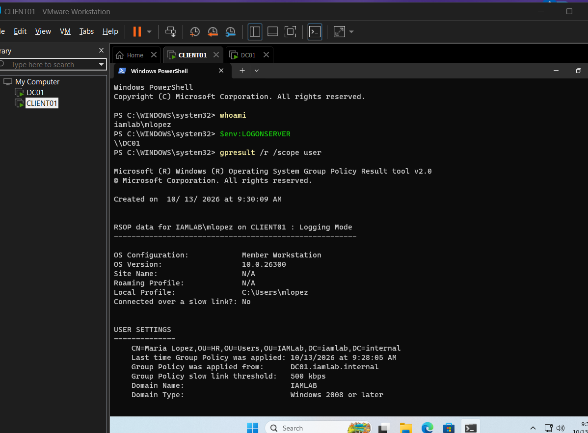

---

## 4. Department File Shares with Group-Based Access

Each department gets a share that only its members can open. Access is granted to **security groups, not individual users**, so when someone changes departments or leaves, removing them from one group removes their access everywhere.

| Department | Security group | Members | Share | Mapped drive |
|---|---|---|---|---|
| HR | `GRP-HR-Users` | Maria | `\\DC01\HR` | H: |
| Finance | `GRP-Finance-Users` | James, Sophie | `\\DC01\Finance` | F: |

```powershell
# Share permissions: only the department group and Domain Admins can connect
New-SmbShare -Name "HR" -Path "C:\Shares\HR" -ChangeAccess "IAMLAB\GRP-HR-Users" -FullAccess "IAMLAB\Domain Admins"

# NTFS permissions: remove inherited "all users can read" and grant only SYSTEM, Administrators, and the group (Modify)
icacls "C:\Shares\HR" /inheritance:r /grant:r "SYSTEM:(OI)(CI)F" "Administrators:(OI)(CI)F" "IAMLAB\GRP-HR-Users:(OI)(CI)M"
```

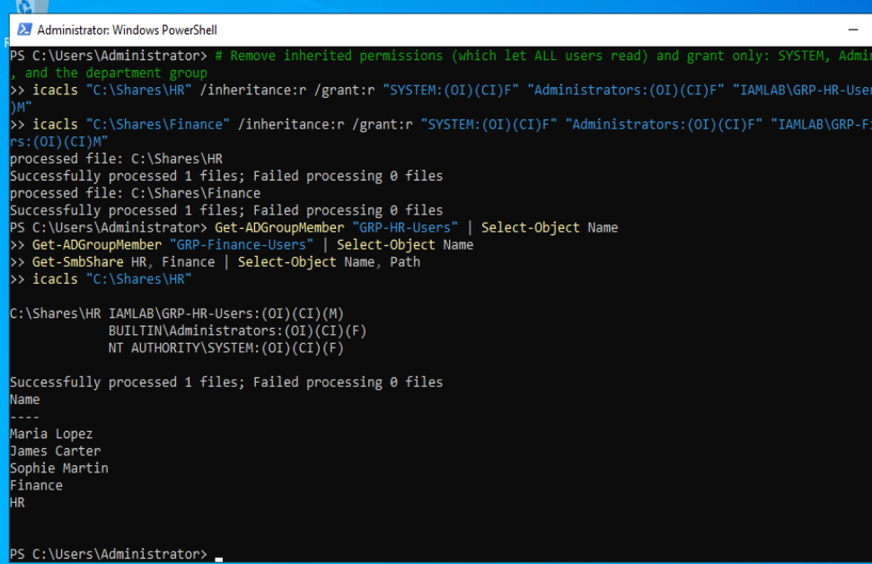

### Drive mapping with Group Policy Preferences
One GPO, **Map Department Drives**, linked to the `IAMLab\Users` OU, maps H: and F:. **Item-level targeting** shows each drive only to members of the matching security group.

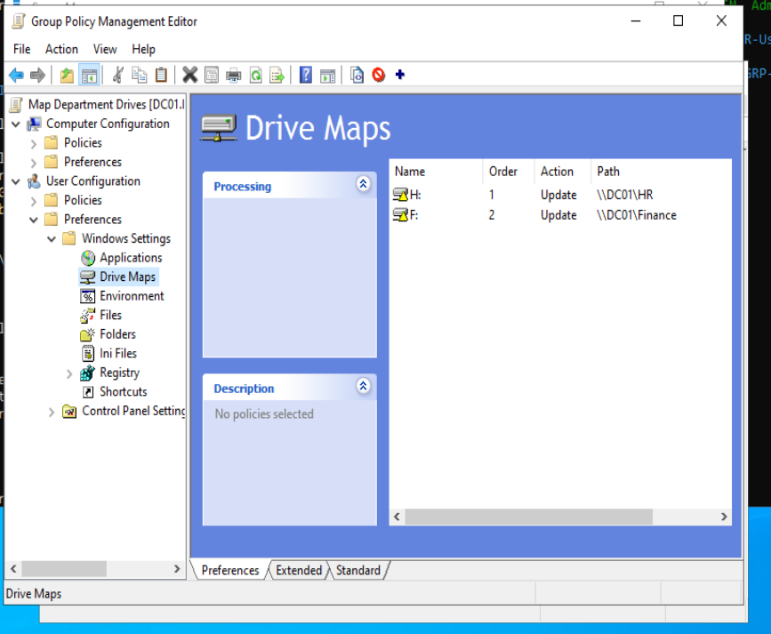

### Proof that least privilege works
As Maria, the H: drive mapped automatically and she could create a file. Opening `\\DC01\Finance` was denied:

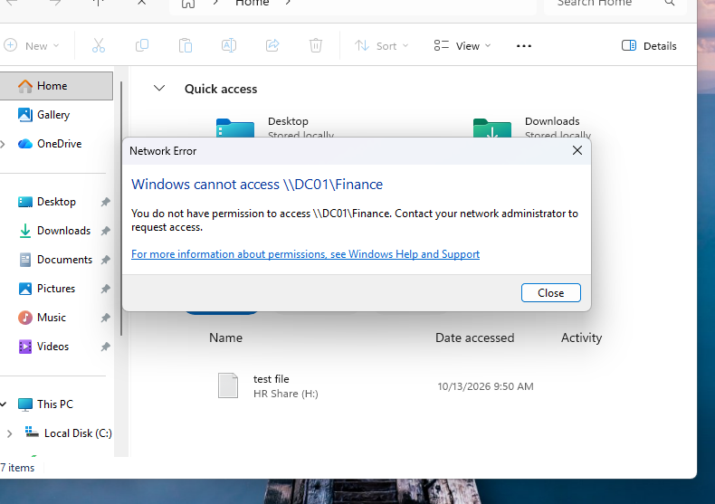

**Note:** Maria was added to her group *after* she had signed in. Windows reads group memberships at sign-in, so she had to sign out and back in before the drive appeared. That's a common cause of "I was added to the group but still can't open the folder" tickets.

---

## 5. Security Policies

A second GPO, **Workstation Security**, is linked to `IAMLab\Computers`:

| Setting | Value | Purpose |
|---|---|---|
| Interactive logon: Machine inactivity limit | 900 seconds (15 min) | Locks unattended screens |
| Interactive logon: Message title / text | "Authorized Use Only" warning banner | Legal notice shown before sign-in |

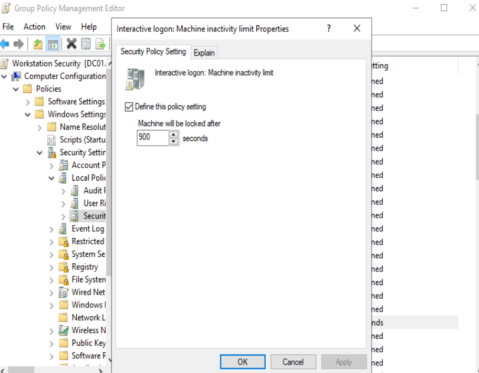

The setting reached CLIENT01's registry:

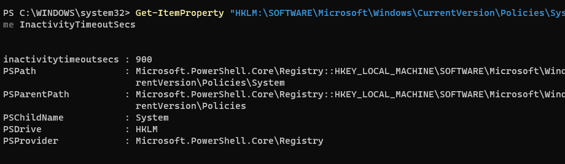

---

## 6. Troubleshooting Scenarios

I broke the lab on purpose, observed the symptoms as the user, then diagnosed and fixed each problem as a technician.

### Scenario 1: Wrong DNS server

> **Ticket:** "Maria Lopez (HR) says her computer can't reach the company network, but the internet still works."

**Simulated cause:** CLIENT01's DNS was switched back to automatic, so it used VMware's DNS (`192.168.51.2`) instead of DC01.

**Symptom:** Group Policy updates failed:

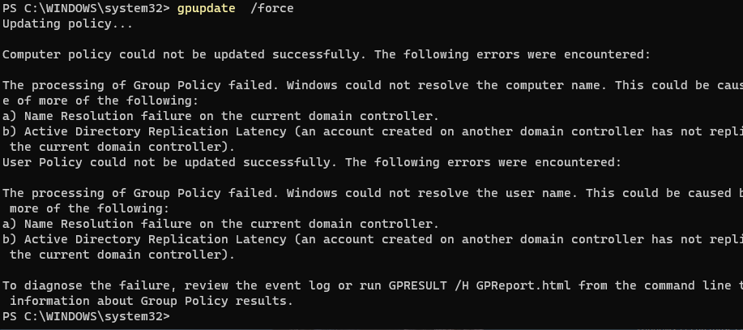

Interestingly, the HR share **still opened**. CLIENT01 had cached DC01's address (the DNS record lasts 600 seconds) and already had an open connection from the mapped H: drive. Problems often look inconsistent like this, which is why caches matter when troubleshooting.

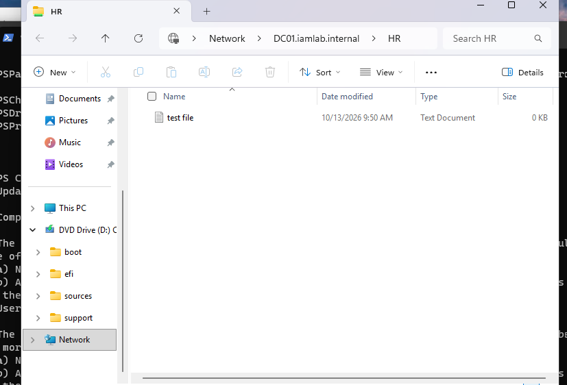

**Diagnosis:**
| Command | Result | Meaning |
|---|---|---|
| `ipconfig /all` | DNS Servers: `192.168.51.2` | The PC is asking the wrong DNS server |
| `nslookup iamlab.internal` | Non-existent domain | That server doesn't know the domain |
| `Test-NetConnection 192.168.51.10 -Port 389` | True | The network path to DC01 is fine |

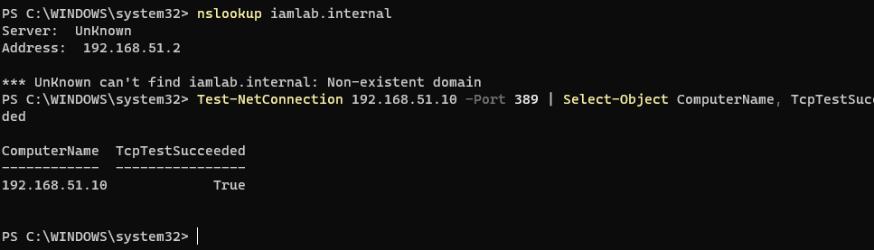

**Root cause:** the network was working, but name resolution wasn't, so CLIENT01 couldn't locate its domain controller.

**Fix:** set CLIENT01's DNS back to `192.168.51.10`. Because Maria is a standard user, the change required elevating with the local admin account at the UAC prompt, the way a technician would at a user's desk.

**Verification:**

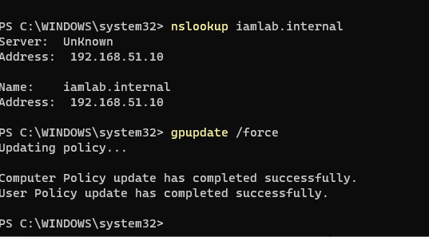

---

### Scenario 2: Policy not applying (computer in the wrong OU)

> **Ticket:** "IT added a login warning banner for all workstations. Other PCs show it, but CLIENT01 doesn't."

**Simulated cause:** CLIENT01 was moved back to the default `CN=Computers` container.

**Diagnosis (client side):** `gpresult /r /scope computer` showed only **Default Domain Policy**. **Workstation Security** was missing:

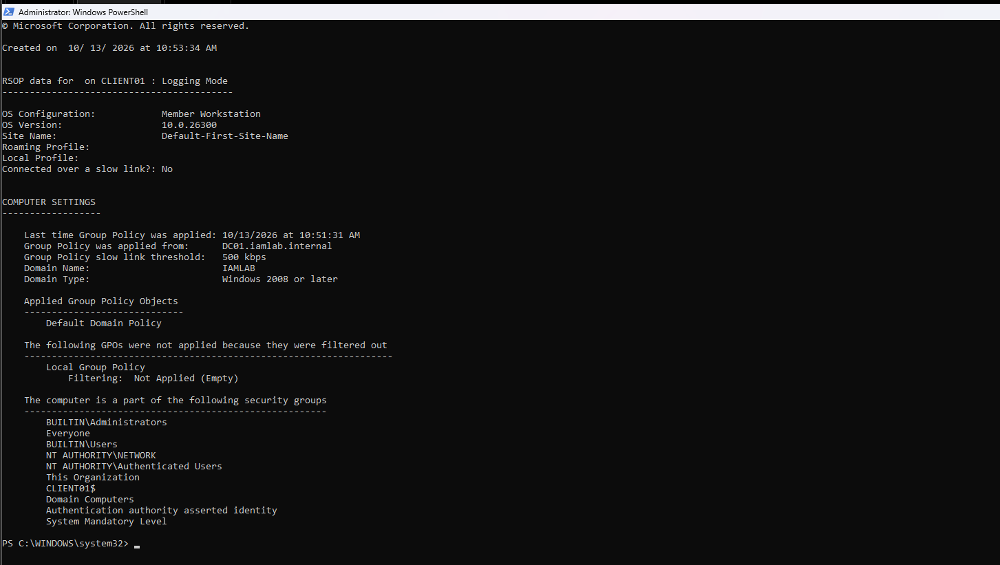

**Diagnosis (server side):** CLIENT01 was sitting outside the OU the policy is linked to:

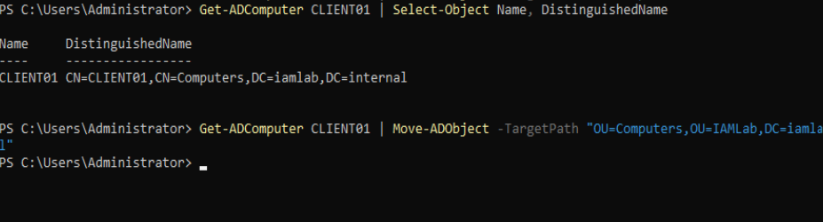

**Root cause:** the GPO is linked to `OU=Computers,OU=IAMLab`, and CLIENT01 wasn't in it.

**Fix:**
```powershell
Get-ADComputer CLIENT01 | Move-ADObject -TargetPath "OU=Computers,OU=IAMLab,DC=iamlab,DC=internal"
```

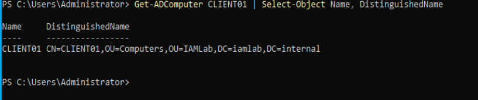

**Verification:** after a restart, Workstation Security appears under Applied Group Policy Objects:

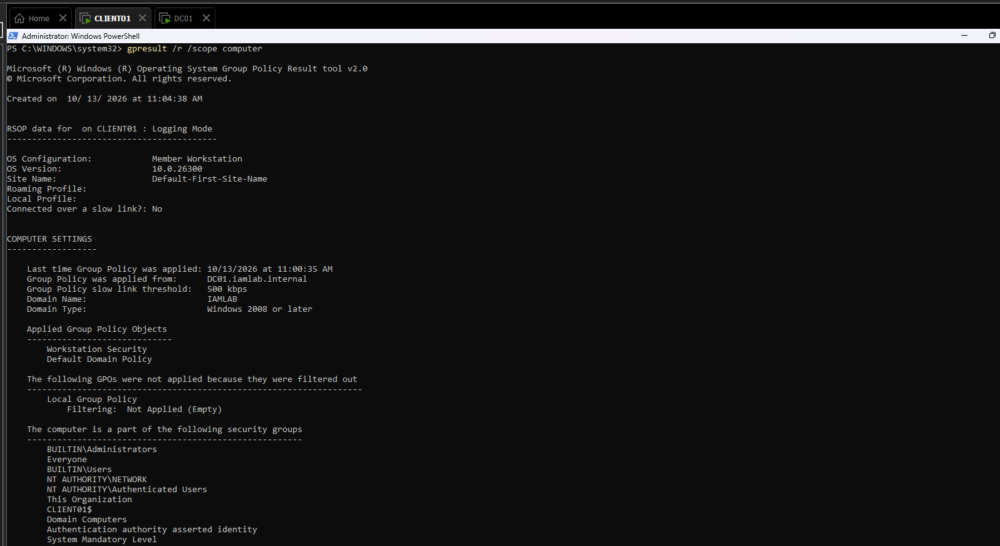

---

## Security Considerations

**Built in:**
- **Least privilege:** department data is limited to department groups, verified with a denied-access test.
- **Group-based access:** permissions are granted to groups, never to individual accounts.
- **Forced password change** on first sign-in for every new account.
- **Standard users** can't change network settings; changes require admin elevation.
- **Secrets handled carefully:** the DSRM password was read as a SecureString, and the BitLocker recovery key was stored off the device before changing boot settings.
- **Host security kept intact** by choosing a hypervisor that works with Windows' VBS instead of disabling it.

**Lab shortcuts I would not use in production:**
- File shares are hosted on the domain controller. In production they belong on a separate file server, because every extra service on a DC adds attack surface.
- All test users started with the same temporary password. In production, each account gets a unique random temporary password.
- Day-to-day admin work used the built-in domain Administrator account. In production, admins use separate named admin accounts and the built-in account is reserved for emergencies.

---

## Lessons Learned

- **Read the logs before changing settings.** The VirtualBox log pointed straight to the hypervisor conflict.
- **DNS is the foundation of Active Directory.** A wrong DNS server broke Group Policy even though the network was up.
- **Caches make problems look inconsistent.** Test with full names (`DC01.iamlab.internal`) and keep cached results in mind.
- **Group membership updates at sign-in.** Users need to sign out and back in after being added to a group.
- **OU placement controls which policies apply.** When a policy is missing, `gpresult` and the computer's OU location are the first things to check.
- **The AD PowerShell module lives on the DC** (or on a technician PC with RSAT), not on regular workstations. I learned this when `Get-ADComputer` wasn't recognized on CLIENT01.
- **Keep time zones consistent.** CLIENT01 was initially set to Pacific time while DC01 used Eastern, so some client screenshots show timestamps 3 hours behind. Mismatched time zones can mislead an investigation when comparing logs.
- **Preview before executing.** I used `-WhatIf` before bulk changes so mistakes showed up before they happened.

---

## Next Steps
- Build a help desk ticketing lab (osTicket on Ubuntu Server) using this same domain and these test users.
- Automate user onboarding and offboarding (Joiner-Mover-Leaver) with PowerShell.
